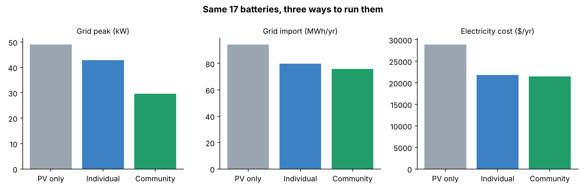
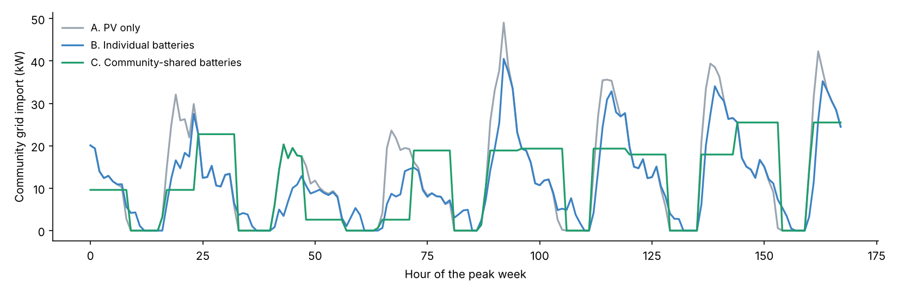

# 01 · Community battery flexibility

**Question:** an energy community already owns 17 home batteries. Does it matter whether each home runs its battery alone, or the community runs them together?

**Short answer:** yes. Run as one shared pool, the same batteries cut the community's grid peak by **40%** (49 kW to 30 kW), against only 13% when each home acts alone. Grid imports, bills and emissions also come down slightly.



## Results (one year, 17 homes)

| Scenario | Grid peak (kW) | Grid import (MWh/yr) | Export (MWh/yr) | Cost ($/yr) | Emissions (t CO2/yr) |
|:--|--:|--:|--:|--:|--:|
| A. PV only, batteries idle | 49.1 | 94.4 | 28.2 | 28,917 | 14.9 |
| B. Each home runs its own battery | 42.8 | 79.9 | 10.9 | 21,855 | 12.4 |
| C. Community-shared batteries | **29.7** | **75.7** | **6.1** | **21,455** | **11.8** |

The peak week shows why. Individual batteries (blue) empty early in the evening and the peak comes back. The shared pool (green) spreads the same energy to hold the whole community under a flat daily cap.



## Why this matters

- **For grid operators:** a lower, flatter peak is what defers grid reinforcement. It is the service local flexibility markets pay for.
- **For energy communities:** shared operation turns many small assets into one flexible resource that can be offered to those markets, in line with the energy sharing and flexibility provisions of the 2024 EU Electricity Market Design reform.
- **For project design:** "who controls the battery" is a design choice with real value, and a natural work package for Horizon Europe and LIFE Clean Energy Transition projects.

## How it works

- **Data:** the [CityLearn Challenge 2022](https://github.com/intelligent-environments-lab/CityLearn) dataset (MIT licence). It covers 17 homes with 4 to 5 kW of PV and a 6.4 kWh / 5 kW battery each, at hourly resolution for one year. Prices and carbon intensity come from the same dataset (US tariff, in $).
- **B. Individual:** each battery charges from its own home's solar surplus and discharges whenever that home draws from the grid.
- **C. Community:** the 17 batteries act as one pool. Each day it finds the lowest import cap it can hold, then discharges above that cap and tops up from the grid in quiet hours below it.
- **Simplifications:** C assumes a perfect day-ahead forecast, which gives an upper bound. There is no battery degradation, and only one network connection point. A forecasting or reinforcement-learning controller is the natural next step.

Run it yourself:

```bash
pip install pandas numpy matplotlib tabulate
python analysis.py
```
