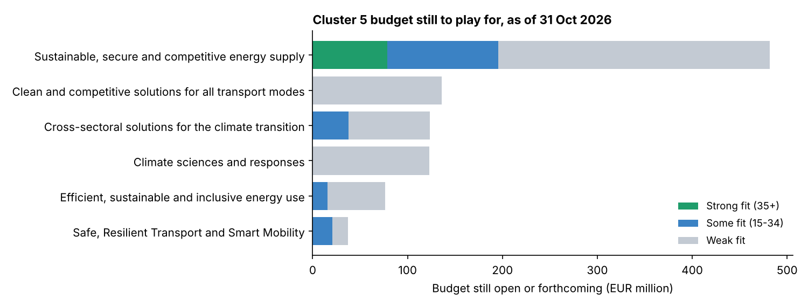
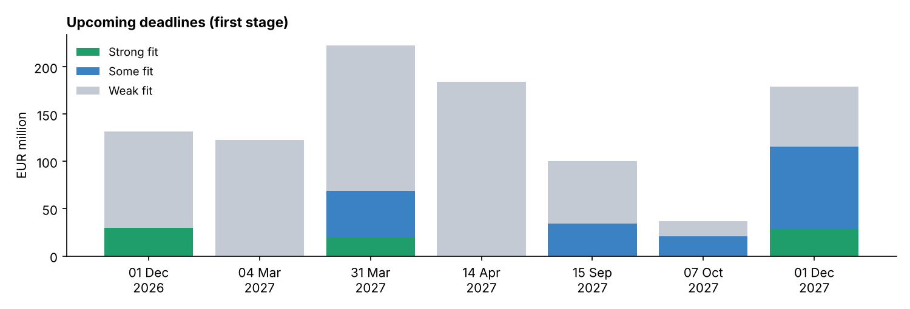

# 02 · EU funding radar: Horizon Europe Cluster 5

**Question:** Horizon Europe's Climate, Energy and Mobility work programme for 2026-2027 is 349 pages long. Which topics are still worth chasing for someone working on energy communities, flexibility and AI for energy?

**Short answer:** of **95 topics worth EUR 1.95 billion**, 54 (EUR 978 million) are still open or forthcoming as of 31 October 2026. About a dozen of them fit this profile. Three fit strongly, and one closes on **1 December 2026**.



## Shortlist (as of 31 Oct 2026)

| Status | Topic | Type | Budget | Per project | Deadline | Fit |
|:--|:--|:--|--:|--:|:--|--:|
| 🟢 Open | [Data sharing to support AI foundation models in the energy sector](https://ec.europa.eu/info/funding-tenders/opportunities/portal/screen/opportunities/topic-details/horizon-cl5-2026-11-d3-23) · `HORIZON-CL5-2026-11-D3-23` | IA, TRL 7-8 | €30m | €10m | **01 Dec 2026** | 44 |
| 🔵 Opens 03 Dec 2026 | [Large-scale validation of (generative) AI tools for a digital energy system](https://ec.europa.eu/info/funding-tenders/opportunities/portal/screen/opportunities/topic-details/horizon-cl5-2027-02-d3-24) · `HORIZON-CL5-2027-02-D3-24` | IA, TRL 7-8 | €20m | €10m | 31 Mar 2027 | 40 |
| 🔵 Opens 04 Aug 2027 | [Advanced Distribution Management Systems for flexible distribution grids](https://ec.europa.eu/info/funding-tenders/opportunities/portal/screen/opportunities/topic-details/horizon-cl5-2027-07-d3-26) · `HORIZON-CL5-2027-07-D3-26` | IA, TRL 6-8 | €28.5m | €9.5m | 01 Dec 2027 | 35 |
| 🔵 Opens 05 May 2027 | [Demonstration of long-duration battery storage (BATT4EU)](https://ec.europa.eu/info/funding-tenders/opportunities/portal/screen/opportunities/topic-details/horizon-cl5-2027-05-d2-08) · `HORIZON-CL5-2027-05-D2-08` | IA, TRL 6-7 | €18.8m | €9.4m | 15 Sep 2027 | 26 |
| 🔵 Opens 04 Aug 2027 | [Advanced TSO control rooms for grid observability and resilience](https://ec.europa.eu/info/funding-tenders/opportunities/portal/screen/opportunities/topic-details/horizon-cl5-2027-07-d3-25) · `HORIZON-CL5-2027-07-D3-25` | IA, TRL 6-8 | €28.5m | €9.5m | 01 Dec 2027 | 24 |
| 🔵 Opens 04 Aug 2027 | [Community of practice: data-driven decision-making in energy](https://ec.europa.eu/info/funding-tenders/opportunities/portal/screen/opportunities/topic-details/horizon-cl5-2027-07-d3-28) · `HORIZON-CL5-2027-07-D3-28` | CSA | €6m | €6m | 01 Dec 2027 | 18 |

The best match in the whole programme was *AI-driven forecasting for grid- and consumer-friendly energy sharing* (`HORIZON-CL5-2026-03-D3-22`, fit 100). It closed in March 2026, so it's a strong signal of where the next calls are heading. The full list of all 95 topics is in [radar.csv](radar.csv).



## Why this matters

- **For applicants:** most of the 2026 budget has already been allocated. The window that matters now runs from 1 December 2026 to the end of 2027, and the strongest energy-system topics are concentrated in the calls closing in March and December 2027.
- **For consortium building:** these topics are Innovation Actions at TRL 6-8 worth around €10m each. They need DSOs, TSOs or energy communities as demo sites from day one, not just research partners.
- **For a consultancy:** the radar takes minutes to re-run whenever a new work programme or amendment is published. Change the profile and it serves another client.

## How it works

1. **Extract:** `radar.py` reads the official work programme PDF. For each of the 95 topics it pulls the call, destination, type of action, total and per-project budget, TRL, opening date and deadline(s). The parsed budgets add up exactly to the programme's own call totals (EUR 1,951.78 million).
2. **Score:** each topic's expected outcomes and scope are scored against a weighted profile. The themes are energy communities and sharing, flexibility, consumers and social aspects, AI and data, grids and storage, buildings and policy. Matches in the title count five times as much. Scores are scaled so the best topic is 100.
3. **Status:** each topic is marked open, forthcoming or closed against a chosen date. For two-stage calls the first-stage deadline is used.

**Limits:** keyword scoring is a first filter, not a judgement. For example, "flexibility" in a battery-recycling topic means flexible processes, not grid flexibility, so read each shortlisted topic before acting. Dates can move, so the [Funding & Tenders Portal](https://ec.europa.eu/info/funding-tenders/opportunities/portal/) is the reference.

Run it yourself (with the Cluster 5 work programme PDF from the Funding & Tenders Portal):

```bash
pip install pandas matplotlib tabulate   # plus pdftotext from poppler-utils
python radar.py "Cluster 5_Horizon Europe Work Programme 2026-2027.pdf" 2026-10-31
```

To point the radar at a different specialism, edit the `PROFILE` dictionary at the top of `radar.py`.
